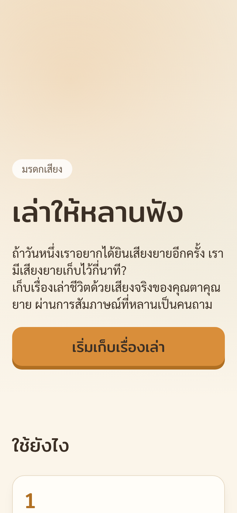
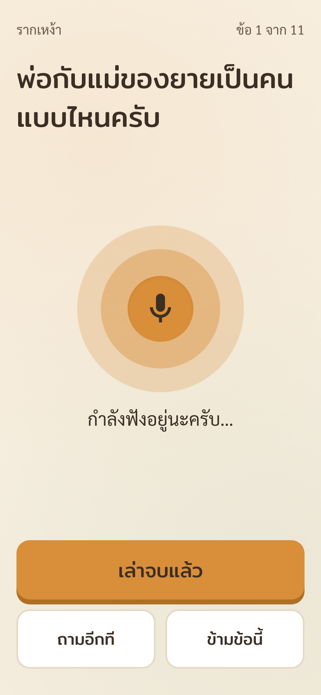
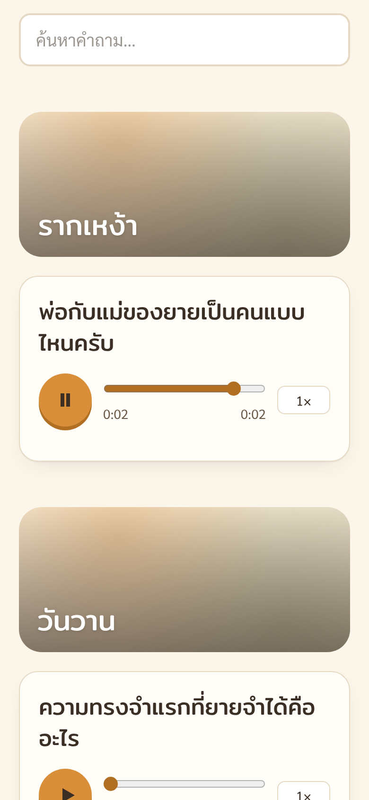

# มรดกเสียง — เล่าให้หลานฟัง

> เว็บช่วยลูกหลานเก็บ **เรื่องเล่าชีวิตด้วยเสียงจริงของผู้สูงอายุ** ผ่านการสัมภาษณ์รวดเดียวจบ ที่ **หลานเป็นคนถามด้วยเสียงตัวเอง**

**Live:** https://moradoksiang.kamnuantech.com (หรือ `มรดกเสียง.kamnuantech.com`)
**บริบท:** การบ้านรอบสัมภาษณ์ YWC21 สาขา Web Programming — ธีม *Re:Humanize the Web*

| หน้าแรก | ยายกดปุ่มเดียว | กำลังฟังคำตอบ | สมุดชีวิต |
|---|---|---|---|
|  |  |  |  |

---

## ปัญหา

- ผู้สูงอายุไทยมี **20%** ของประชากร (2567) และคนที่อยู่คนเดียวเพิ่มจาก 3.6% (2537) เป็น **12.9%** (2567) — สำนักงานสถิติแห่งชาติ
- เรื่องเล่าในครอบครัวหายไปพร้อมคน และสิ่งที่หลานอยากได้คืนมากที่สุดมักเป็น *เสียง* ไม่ใช่ข้อความ
- Meta-analysis ([PMC10603902](https://pmc.ncbi.nlm.nih.gov/articles/PMC10603902/)) พบว่า life review / reminiscence ช่วยเพิ่มคุณภาพชีวิตและความพึงพอใจในชีวิตของผู้สูงอายุ — **แค่ได้เล่า ยายก็ได้ประโยชน์แล้ว**
- บริการที่มีอยู่ (Storyworth, Remento, StoryCorps) เป็นภาษาอังกฤษ ต้องพิมพ์ หรือต้องเสียเงิน → ช่องว่าง: **ภาษาไทย + เสียงล้วน + หลานถามด้วยเสียงตัวเอง**

## แนวคิด Humanize

1. **AI/ระบบเป็นแค่คนถามและคนจัดเก็บ ไม่ใช่คนเล่า** — ไม่เรียบเรียง ไม่แต่งเรื่องแทน สิ่งที่เก็บคือเสียงจริงที่ AI สร้างแทนไม่ได้
2. **หลานอัดเสียงคำถามเอง** — ยายได้ยินเสียงหลานถาม ไม่ใช่เสียงหุ่นยนต์ (TTS ภาษาไทยเป็นแค่ fallback)
3. **เสียงอยู่ที่บ้าน** — self-hosted ไฟล์เสียงไม่ไปคลาวด์ของใคร การถอดความก็รันในเครื่อง (faster-whisper)

## ฟีเจอร์

**ลูกหลาน** — สร้างสมุดชีวิตใน < 1 นาที · ชุดคำถามเริ่มต้น 10 ข้อ (เบา → ลึก มีเพลงกล่อมลูกคั่นกลาง จบด้วยข้อความถึงอนาคต) หรือเลือกจากคลัง 26 ข้อ / เขียนเอง · เรียงลำดับ · **อัดเสียงตัวเองถามทีละข้อ** · ลิงก์ + QR 3 แบบ (จัดการ / ให้ผู้เล่า / สมุดชีวิต) · ลบข้อมูลทั้งหมด (PDPA)

**ผู้สูงอายุ** — ปุ่มใหญ่ปุ่มเดียว "เริ่มคุยกัน" แล้วคุยต่อเนื่องจนจบ:
เล่นเสียงคำถาม → "ติ๊ง" → อัดอัตโนมัติ → วงกลมเต้นตามเสียง →
เงียบ 6 วิ ถามเบา ๆ ว่าเล่าต่อไหม · เงียบต่ออีก 8 วิ จบข้อเอง · ไม่พูดเลย 20 วิ ถามซ้ำ 1 ครั้ง →
อัปโหลดเบื้องหลัง → ข้อต่อไป · ปิดกลางทางแล้วเปิดใหม่ **ต่อจากข้อเดิม** · เน็ตหลุดก็ไม่หาย (เก็บใน IndexedDB แล้ว retry) · กันจอดับ (Wake Lock) · ตัวอักษร ≥ 22px ปุ่มสูง ≥ 72px ไม่มีสีแดง ไม่มีตัวนับเวลากดดัน

**ครอบครัว** — สมุดชีวิตแบ่งบทตามช่วงชีวิต · player ที่ seek ได้ทั้ง Safari/Chrome + ปรับความเร็ว · **เล่นทั้งเล่ม** (เสียงหลานถาม → เสียงยายตอบ → ตอนถัดไป) · คำถอดความแบบพับเก็บ + ค้นหา · แชร์ลิงก์ / QR

## Tech Stack

| ส่วน | ใช้ |
|---|---|
| Framework | Next.js 15 (App Router) + TypeScript, `next start` บนเครื่องที่บ้าน |
| UI | Tailwind CSS 4, ฟอนต์ Sarabun + Mitr |
| DB | SQLite (better-sqlite3, WAL) + Drizzle ORM |
| ไฟล์เสียง | ดิสก์ `data/files/`, เสิร์ฟผ่าน API ที่ตรวจ token + รองรับ HTTP Range |
| อัดเสียง | MediaRecorder (webm/opus บน Chrome, mp4/aac บน iOS) → ffmpeg แปลงเป็น AAC `.m4a` |
| ตรวจความเงียบ | Web Audio API (AnalyserNode → RMS) + state machine ที่เทสต์ได้ |
| TTS fallback | Web Speech API (`th-TH`) |
| ถอดความ | faster-whisper (`small`, int8) — Python worker แยก process |
| Expose | Cloudflare Tunnel (HTTPS — จำเป็นต่อไมค์บนมือถือ) |
| Process | pm2 (web + worker + tunnel) |
| Test | Vitest (unit + API), Python unittest (worker), Playwright (E2E ไมค์ปลอม) |

```
 มือถือยาย / หลาน / ญาติ
        │ HTTPS
        ▼
 Cloudflare Tunnel ──► Next.js (localhost:3000) ──► SQLite  data/app.db
                          │  ffmpeg → .m4a              ▲
                          └──► data/files/ (เสียง, รูป)   │ poll ทุก 5 วิ
                                       ▲                 │
                                       └──── faster-whisper worker (Python, ในเครื่อง)
```

**ไม่มีระบบ login** — ใช้ *capability link*: token สุ่ม 24 ตัวอักษร (~143 bit) แยกสิทธิ์ 3 ระดับ

| ลิงก์ | ทำอะไรได้ |
|---|---|
| `/m/{manageToken}` | แก้ไขทุกอย่าง ลบได้ ฟังได้ทุกเสียง |
| `/r/{recordToken}` | ตอบคำถาม ฟังเสียงคำถามของหลาน — **ฟังคำตอบเก่าไม่ได้** |
| `/b/{bookToken}` | ฟังอย่างเดียว |

หน้าเหล่านี้ใส่ `noindex` และ `robots.txt` กันไว้

## โครงสร้าง

```
app/                 หน้าเว็บ + API route handlers
  r/[token]/         หน้าสัมภาษณ์ (InterviewClient)
  m/[token]/         หน้าจัดการ   b/[token]/  สมุดชีวิต   new/  สร้างใหม่
  api/               storytellers, m/, r/, b/, audio/{answer|prompt}/[id], photo
lib/                 logic ล้วน (เทสต์ได้): questions, silence, interview, uploadQueue,
                     range, mime, tokens, repo, schema, audio, storage
lib/client/          ส่วนที่ผูกกับเบราว์เซอร์: AudioEngine, IndexedDB store
components/          VoiceOrb, BigButton, AudioCard, PromptRecorder, Art
worker/              transcribe.py (faster-whisper) + เทสต์
tests/               Vitest specs     e2e/  Playwright
scripts/seed-demo.ts สร้างสมุดชีวิตเดโม
```

## รันบนเครื่อง

ต้องมี Node.js 20+, ffmpeg (และถ้าจะถอดความ: Python 3.10+)

```bash
npm install
cp .env.example .env.local      # แก้ NEXT_PUBLIC_BASE_URL เป็น http://localhost:3000 ถ้าทดสอบในเครื่อง
npm run dev                     # http://localhost:3000
```

ทดสอบ

```bash
npm test                                   # unit + API (ต้องมี ffmpeg)
python3 -m unittest discover -s worker     # worker
npm run build && npm start                 # แล้วอีก terminal:
BASE=http://localhost:3000 npm run e2e     # E2E ด้วย Chromium + ไมค์ปลอม
```

> ไมค์บนมือถือใช้ได้เฉพาะ HTTPS (หรือ localhost) — ทดสอบบนมือถือให้ผ่าน tunnel

ถอดความ (ไม่บังคับ — ถ้าไม่รัน หน้าเว็บจะซ่อนส่วนคำถอดความเอง)

```bash
python3 -m venv .venv && . .venv/bin/activate
pip install -r worker/requirements.txt
DATA_DIR=./data python worker/transcribe.py
```

สมุดชีวิตเดโม

```bash
npm run seed:demo -- ./demo-audio    # โฟลเดอร์เสียงจริง (ดูรูปแบบในหัวไฟล์ scripts/seed-demo.ts)
# แล้วใส่ DEMO_BOOK_TOKEN ที่ได้ลง .env.local เพื่อโชว์ปุ่ม "ฟังสมุดชีวิตตัวอย่าง" หน้าแรก
```

## Deploy บนเซิร์ฟเวอร์ที่บ้าน

```bash
npm ci && npm run build
npm i -g pm2

# Cloudflare Tunnel (โดเมนต้องใช้ DNS ของ Cloudflare)
cloudflared tunnel login
cloudflared tunnel create moradoksiang
cloudflared tunnel route dns moradoksiang moradoksiang.kamnuantech.com
cloudflared tunnel route dns moradoksiang xn--12cm1bzchd5c2ere.kamnuantech.com   # มรดกเสียง (ไม่บังคับ)
cp cloudflared/config.example.yml cloudflared/config.yml                       # ใส่ path credentials

pm2 start ecosystem.config.js     # web + worker + tunnel
pm2 save && pm2 startup           # รันเองหลังรีบูต
```

- Cloudflare แบบฟรีรับ body ได้ ~100MB/request — คำตอบละ 15 นาทีของ iPhone ≈ 15MB เหลือเฟือ (server จำกัด 30MB)
- ปิด sleep ของเครื่อง เสียบปลั๊กไว้

## การพัฒนาแบบ TDD

ทุกโมดูล logic เขียนเทสต์ก่อน (commit `test:` ที่ล้ม) แล้วค่อยเขียนโค้ดให้ผ่าน (commit `feat:`) — ดูได้จาก `git log`

- **silence detector** เป็น state machine ที่รับเวลาจากภายนอก → เทสต์ 6 วิ / 8 วิ / 20 วิ ได้ในเสี้ยววินาที
- **interview reducer** แยก flow ออกจาก React → เทสต์ทุก transition รวมถึงกัน auto-end มาช้าแล้วข้ามสองข้อ
- **upload queue** inject storage + sleep → เทสต์ retry/backoff/ลำดับ/ไม่ส่งซ้ำ โดยไม่ต้องมีเน็ตจริง
- **API** เรียก route handler ตรง ๆ กับ SQLite + ffmpeg จริงในโฟลเดอร์ชั่วคราว
- **E2E** Playwright เปิด Chromium + ไฟล์เสียงปลอมแทนไมค์ เดินครบ: สร้าง → ตรวจไมค์ → ตอบ 3 ข้อ → ข้าม → รีโหลดแล้ว resume → สมุดชีวิตเล่นเสียงได้
- CI (GitHub Actions) รัน typecheck + เทสต์ทั้งหมด + build ทุก push

## การใช้ AI agent

- **ตัดสินใจเอง:** แนวคิด, ข้อมูลรองรับ, คลังคำถามและลำดับชุดเริ่มต้น, หลัก Humanize (หลานถามเอง / ไม่ให้ AI แต่งเรื่อง / self-host), UX ของหน้าผู้สูงอายุ, ค่าเวลาตรวจความเงียบ, design tokens, แผนงานทั้งหมด และการเลือกพัฒนาแบบ TDD
- **ให้ Claude Code ช่วย:** เขียนโค้ดและเทสต์ตามแผน ภายใต้รอบ red → green ที่ตรวจทีละขั้น
- _(TODO: เติมส่วนที่ปรับแก้เองหลังทดสอบกับผู้สูงอายุจริง)_

## ข้อจำกัดที่รู้

- iOS ต้องกด "เริ่มคุยกัน" ทุกครั้งที่เปิดหน้า (นโยบาย autoplay/ไมค์ของ Safari) — ออกแบบให้เป็นการกดครั้งเดียว
- บางเครื่องไม่มีเสียง TTS ภาษาไทย → แสดงคำถามตัวใหญ่แทน (จึงแนะนำให้หลานอัดเสียงเอง)
- เปิดจากในแอป LINE อาจใช้ไมค์ไม่ได้ ต้อง "เปิดในเบราว์เซอร์"
- คำถอดความภาษาถิ่นอาจคลาดเคลื่อน — เสียงคือข้อมูลหลัก ข้อความเป็นแค่ตัวช่วยค้นหา
- เซิร์ฟเวอร์เครื่องเดียวที่บ้าน: ถ้าไฟดับ/เน็ตบ้านล่ม เว็บก็ล่ม (คิวอัปโหลดฝั่งมือถือช่วยไม่ให้คำตอบหาย)
- rate limit อยู่ในหน่วยความจำ (เหมาะกับ process เดียว)

## พัฒนาต่อ

AI ถามคำถามต่อยอดจากคำตอบ · ตั้งชื่อตอนอัตโนมัติจากคำถอดความ · Export หนังสือ PDF ที่มี QR เปิดเสียงแต่ละตอน · waveform · ถ้าผู้ใช้เยอะ: object storage + Postgres + คิวถอดความแยก · ร่วมกับ รพ.สต. / ชมรมผู้สูงอายุ
